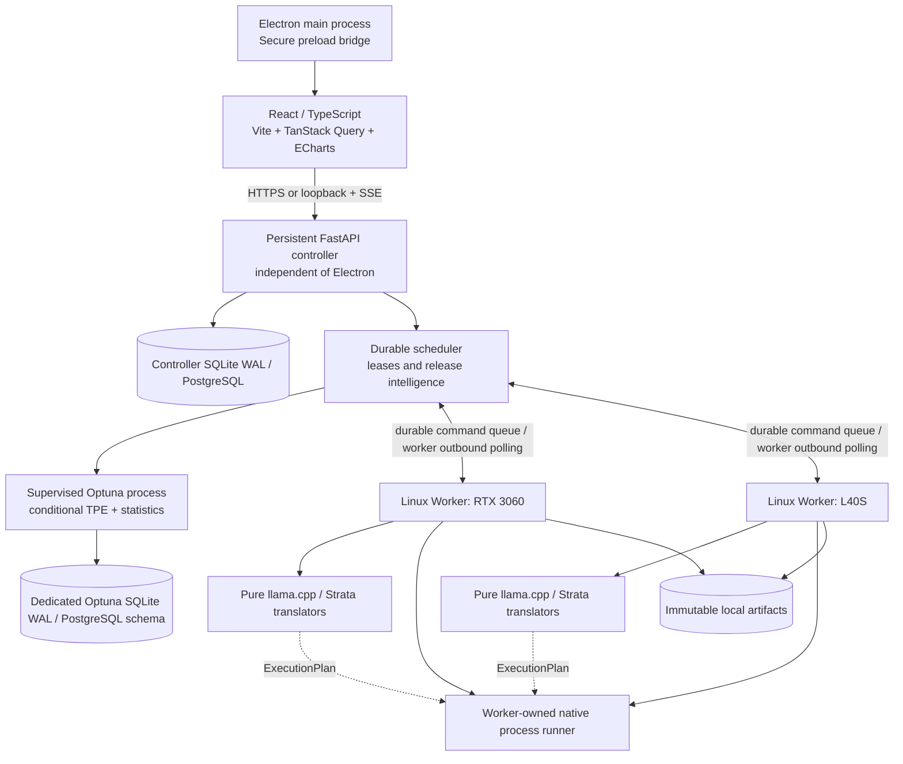

# AI Inference Optimization Lab
## Product Requirements Document & Technical Implementation Plan — Electron Edition

| Attribute | Decision |
|---|---|
| Document ID / version | AI-IOL-PRD-003 / 2.1 |
| Date | 2026-10-20 |
| Status | Phase 0/1-ready revised design baseline; hardware and adapter qualification still required |
| Product | Local-first desktop inference optimization laboratory |
| Desktop | **Electron + React + TypeScript + Vite** |
| Control plane | **Python 3.12+ + FastAPI**, independently running Linux service |
| Compute/optimization | **Python Linux worker services + Optuna + native engines** |
| Initial engines | **llama.cpp** and **Strata** ONLY |
| Next engines | Adapter contract designed for expansion; no third engine shipped in v1 |
| Optimization objectives | Balanced / Maximum Generation / Maximum Prompt Processing |
| Context matrix | 4K, 8K, 16K, 32K, 64K, 128K |
| Search depth | Quick / Standard / Thorough |
| Persistence | Isolated SQLite controller/Optuna stores for standalone; PostgreSQL for multi-worker deployments |
| Distribution | Linux desktop `.deb` and AppImage; Linux native workers under systemd |
| Operating mode | Offline by default; outbound update checks strictly opt-in |

**Architecture decision (v2.1):** Electron + React + TypeScript for the operator UI; a persistent Linux FastAPI control service, an independently supervised Python optimization process and native Linux worker daemons for all benchmark work. In standalone mode use isolated SQLite stores and explicit cross-store reconciliation; use PostgreSQL for central deployment. Adapter implementations are pure, typed command translators and evidence parsers; the worker's single process runner owns all OS effects. Electron never owns jobs, engines or long-running processes.

**v2.1 review disposition:** incorporates feedback on database contention, event-loop isolation, outbound worker command queues, GPU contamination, Linux keyrings, adapter purity, full-context feasibility, OOM-aware search, generated TS contracts, SSE backpressure and system-level systemd units. Corrects three unqualified assertions: Optuna does not learn from `FAIL` trials through `constraints_func`; KV allocation must be verified for the *effective* llama.cpp serving configuration; ECharts SVG/Canvas selection does not by itself guarantee zero renderer GPU use.

---

## 1. Executive summary and product boundaries

Build a desktop-first **AI Inference Optimization Lab** that identifies installed models and native engine builds, discovers effective hardware/engine capabilities, runs controlled benchmark/quality workloads, searches configurations adaptively, and creates evidence-backed launch recipes. The goal is the **best validated configuration found within the selected search budget**, not a mathematical global optimum.

The product serves two initial test environments: an Ubuntu host with an RTX 3060 12 GB and 32 GB system RAM; and a Linux host with an NVIDIA L40S 48 GB. Hardware profiles, compatibility results and recipes are machine/build-specific. The app must support additional Linux hosts without redesigning the UI.

**Mandatory invariants**
1. Original model weights, installed engines and user serving configurations are read-only during inventory and optimization. Run candidates in separate, owned sandboxes.
2. No benchmark is executed inside Electron, React or Chromium. UI closure, UI crash and desktop upgrades **must not** terminate controller-managed experiments.
3. Results identify immutable engine binary/build, model artifacts, GPU, driver, dataset/protocol, parameter vector, effective context and raw evidence.
4. Only runtime-supported parameters are proposed. An adapter must reject unsupported model/backend/flag combinations without guessing compatibility.
5. A result is never called validated if its declared context was not genuinely exercised, if its model/engine identity is unproven, or if required quality/stability gates failed.
6. Engine releases and recommended recipes cannot silently replace existing deployments. Approval, smoke test and rollback are separate operator actions.
7. Internet egress is disabled by default. All benchmark and data management functions work offline using installed models and engines.
8. A Strata model pack is not interchangeable with an arbitrary GGUF model. Cross-engine comparisons require demonstrably equivalent models/tokenizers and workload semantics; otherwise report separate results only.

### 1.1 Goals
- One desktop wizard to run a parameter search across user-selected context lengths and objectives.
- Full support for native llama.cpp and Strata tools, with a common metrics schema and engine-specific tuning.
- Per-context recipe winners plus optional cross-context compromise, with experimental confidence and detailed resource demands.
- Long-running, recoverable jobs; reconnect from Electron or optional browser UI; live monitoring and full historical reports.
- Source/build-aware update intelligence with targeted A/B reruns and explicit upgrade/no-upgrade recommendations.
- Extensible SDK with a conformance-tested **mock third adapter** but no shipping integration for a third inference engine.

### 1.2 Out of scope for release 1
- Implementing any third production inference engine, model training, quantization, fine-tuning, cloud workers, SaaS accounts, public leaderboards, automatic download of large model files, and unapproved production restarts.
- Windows benchmark workers (Linux workers only); packaging a Windows/macOS Electron client may be added later without supporting Windows/macOS execution workers.
- Automated tensor-parallel/multi-GPU tuning, non-text multimodal evaluation and production multi-tenant serving optimization. Capability metadata may anticipate them; these are later gates.

## 2. Users, operating modes and measurable outcomes

### 2.1 Personas
- **Inference engineer / operator:** builds model inventory, sets a target objective, runs optimization and exports exact configuration.
- **Performance reviewer:** audits confidence, resource headroom, context consistency, quality tests and before/after version reports.
- **Lab administrator:** manages worker enrollment, engine trust, allowlisted paths, retention, API access and deployment approvals.

### 2.2 Modes
- **Standalone workstation:** Electron on Linux with persistent system-level FastAPI controller, supervisor-managed optimizer process and local Linux worker. Controller SQLite WAL and Optuna SQLite storage are separate files, with event-mediated reconciliation. Suitable for one active GPU job; PostgreSQL optional.
- **Distributed on-prem lab (recommended for two machines):** Electron on operator PC; central FastAPI + PostgreSQL; dedicated optimizer process and outbound-connected systemd Linux worker daemons on each GPU machine; binary/model files remain on their workers. Multiple Electron clients may connect with operator authorization.
- **Browser companion:** FastAPI may serve the same React SPA on the local LAN. The browser may inspect, plan and control jobs through the authorized API but has no Electron-only filesystem privileges. Browser mode is optional, no duplicate frontend codebase.

### 2.3 Product success metrics
- Time to begin a valid experiment after registration and preflight: **<= 10 UI interactions**, excluding OS-level setup.
- Result completeness: **100% of recommended recipes** contain measured full-scope context evidence and pinned binary/model identities.
- State durability: **zero completed trial loss** when Electron closes/crashes and is relaunched; controller restarts resume safely via reconciliation.
- Integrity: all report scores can be deterministically recomputed from immutable observations to implementation-defined numerical tolerance.
- No silent modifications of existing engines, model data, or production service configs.
- Verified end-to-end run for both target GPU systems and each installed compatible engine; unfit 128K attempts generate explicit infeasibility records rather than placeholder numbers.

## 3. Electron / React user experience requirements

### 3.1 Desktop information architecture

**Primary navigation:** Overview · Models · Engines · Workers · Optimize · Live Runs · Compare · Recipes · Updates · Settings.

| Screen | Critical elements | Operator decisions |
|---|---|---|
| Overview | Worker status, GPU memory, active jobs, last successful recipes, engine update notices | Reconnect, open study, view problems |
| Models | Scoped filesystem discovery, GGUF/Strata manifests, quant, shards, compatible engines, hash status | Select model, verify artifact, inspect compatibility |
| Engines | Installed binary paths, build fingerprints, command capability differences, version history | Register/pin build, select engine |
| Workers | GPU UUIDs, driver/kernel/CPU/RAM, health, service status, leases, contamination warnings | Enable worker, set allowlisted roots, run preflight |
| Optimize | Six-step experiment wizard and advanced search limits | Launch one immutable optimization study |
| Live Runs | Stage timeline, trial grid, charts, telemetry and logs; pause/cancel/resume | Inspect progress independently of UI process |
| Compare | Per-context PP/TG trends, TTFT, VRAM, statistical confidence, Pareto frontier | Compare candidates or versions |
| Recipes | Exact command/profile, hashes, confidence, constraints, exports, provenance, promotion/rollback | Export, verify, approve, deploy to lab-owned service |
| Updates | Release/build feeds, impact classifications, suggested targeted reruns | Pin, defer or qualify updated engine |
| Settings | Backend connection, policy, proxy/no-egress, retention, UI refresh cadence, secrets | Configure safe defaults |

### 3.2 Experiment wizard — precise inputs
1. **Target:** worker/GPU, installed engine (`llamacpp|strata`), compatible installed model/model revision. Show why incompatible choices cannot be selected.
2. **Objective:** `balanced`, `generation_max`, `prefill_max`. Balanced weights prompt/decode normalized ratios equally by default; no undisclosed scoring weights.
3. **Contexts:** multi-select `[4096,8192,16384,32768,65536,131072]`; display 4K/8K/16K/32K/64K/128K and feasibility badges. Allow selecting infeasible targets as requested analysis targets, but report *infeasible* instead of fabricating measurements.
4. **Search depth:** Quick / Standard / Thorough. Advanced panel for trial cap, wall-clock/GPU-hour cap, min free VRAM/RAM, quality policy, repeat count and candidate flags.
5. **Preflight:** read-only report showing ownership, expected storage demand, native binaries, candidate count limit, context fit projections and unknowns; block an unsafe environment.
6. **Submit:** immutable experiment review, persistent job creation, live progress and close-app-safe status. Submission returns a real job ID only after durable commit.

### 3.3 Live experiments
- Show discrete phases: queued, preflighted, baseline, candidate screening, refinement, finalist validation, report creation, completed or terminal error.
- Real-time event timeline with stage, elapsed time, candidate count, estimated remaining *work units* (not a guaranteed wall-clock ETA), and current process ownership.
- Chart native PP/TG and **separate** API latency/TTFT; distinguish `measured`, `estimated`, `unavailable`, `invalid`, `infeasible` and `screening_only`.
- GPU telemetry: used/free VRAM, utilization, temperature, power and clocks if supported, with sampling coverage. No data must be invented when NVML cannot expose a metric.
- No auto-resume if worker state is ambiguous or unsafe. Display reconciliation/inspection actions.
- Pause takes effect at safe trial boundaries. Cancel sends a durable request and escalates SIGTERM→SIGKILL to worker-owned processes only.

### 3.4 Results UI
- **Per-context rankings:** separate verified winner at each context, strongest alternatives and baseline, with delta %, confidence, peak memory and quality/TTFT guards.
- **Cross-context comparison:** geometric-mean aggregate over the *same complete set* of feasible selected contexts. Partial winners appear in a separate panel.
- **Pareto explorer:** PP vs TG (and optional VRAM color/size), filters by context, engine, build, worker and quality/validation status.
- **Release comparison:** same model/dataset/hardware pinned A/B; separate engine defaults and retuned new build results.
- **Recipe viewer:** effective argv/env, path mapping, build/source fingerprints, reproducibility details, export JSON/YAML/bash/systemd (Strata native profile too).

### 3.5 Desktop interactions
- Tray indicator for connection and active jobs (does not imply Electron owns jobs), native notifications, keyboard shortcuts, recent experiments, local file picker only for **client-side** paths.
- Remote model paths are selected from worker-authorized roots returned by API, **not** Electron client filesystem paths.
- Clipboard/copy command, save report with native dialog, open evidence directory when on same host; on remote runs download sanitized artifacts through API.
- Dark/light system theme, 1080p default layout, responsive at minimum 1280×720; charts and tables virtualized for large experiments.
- UI resilient to API disconnect; reconnect with backoff and resynchronize from event sequence offset and snapshot.

## 4. Architecture and deployment



### 4.1 Hard lifecycle boundary
- Install controller, optimizer supervisor and workers as **system-level** `systemd` units (`/etc/systemd/system`), running as dedicated unprivileged users. Never depend on a desktop login session or user-unit lingering. System-unit setup requires explicit administrator authorization; on managed central deployments the same lifecycle invariants apply.
- Worker is also an independent service under `systemd`, **not** a Python child of Electron. It owns engine child PIDs/process groups and artifacts.
- Electron main can open the desktop UI and optionally guide installation/enrollment, but **never** launches or owns long-running trial processes. `app.quit()` only closes UI connections.
- A controller restart reconciles durable experiment state, worker process ownership, heartbeats and artifact journals before reassigning work. No automatic takeover from a lease timeout alone.
- For a local single-host installation, service setup is a one-time explicit installation step and uses dedicated permissions and data directories. Uninstall must offer *keep experiments/models/engines*.

### 4.2 Service boundaries
- **Electron main:** windows, system tray, updates, safe file dialogs, tightly scoped OS integrations. No backend optimizer, no engine launch.
- **Preload bridge:** tiny allowlisted typed RPC for clipboard/save/notifications; never generic filesystem or shell access.
- **React UI:** operator input, visualization, controlled API calls, local cached view state only.
- **FastAPI:** auth, model+engine registries, scheduling, immutable experiment definitions, result aggregation, release notices, audit, recipe approval/promotion workflows, SSE.
- **Optuna component:** **mandatory supervised separate Python process** owns `study.ask/tell`, bounded candidate generation and isolated storage. FastAPI communicates over a durable controller queue/IPC, never invokes synchronous sampling on the asyncio event loop. Bootstrap/statistical workloads run in an isolated process pool with bounded concurrency and timeout.
- **Linux worker:** hardware capability probe, executable/version discovery, workspace/lease enforcement, child process lifecycle, native metrics, stream/upload of evidence metadata. No uploads of weight files.
- **Adapter packages:** `llamacpp` and `strata` only. Strict dynamic capabilities with explicit version provenance.

### 4.3 Data and event flow
1. UI `POST /experiments/plan` → controller validates IDs against **cached, versioned worker and capability snapshots**; no synchronous worker network call. A stale or unknown snapshot returns `PREFLIGHT_REQUIRED` plus a queued scan/preflight command ID, not a guessed runnable plan.
2. UI `POST /experiments` with immutable plan digest and idempotency key → controller commits queue row and returns ID.
3. Worker **pulls commands** (`SCAN`, `PREFLIGHT`, `CLAIM_TRIAL`, `PAUSE`, `CANCEL`, `VERIFY_RECIPE`, `PROMOTE`) through authenticated outbound HTTPS polling (or future WS), acknowledges command ID, obtains job lease, performs GPU checks, and emits journaled events.
4. Worker executes baseline, candidates, paired repeats and validators; writes raw evidence locally and uploads checksums/sanitized metrics.
5. Controller computes verified scores, stores immutable results and generates recipes; Electron receives SSE, reconnectable by event sequence.
6. User reviews recipe and optionally approves deployment to a **lab-owned** serving slot; no existing inference service is altered without explicit supported integration.

### 4.4 Persistent storage — controller/optimizer separation
- **Standalone:** two local SQLite WAL files: `controller.sqlite3` for jobs, snapshots, events, audit, recipes and `optuna.sqlite3` for Optuna RDBStorage. Each process owns its own connection pools. **WAL permits concurrent readers but only one writer per database at a time**; two files avoid *cross-component lock contention*, not contention inside each file, and do not provide atomic cross-database transactions.
- **Controller write discipline:** short transactions, bounded write batching through one logical command owner, optimistic revisions, no long-lived database transaction spanning network calls or benchmark processes. Optuna is accessed only from a supervised independent optimizer process; FastAPI never touches Optuna's SQLite store directly. The optimizer talks to controller via an outbox/inbox journal with stable `study_id`, `trial_id`, `candidate_digest`, monotonically increasing commit sequence, and at-least-once delivery with deduplication. On restart reconcile pending observations against study trial states before issuing any new suggestion. Never mark a worker observation as `reported` until its controller commit is durable.
- **SQLite pragmas:** set `journal_mode=WAL` during DB initialization, and `busy_timeout=10000` per connection; `synchronous=NORMAL` can improve performance but trades some power-failure durability. Use `synchronous=FULL` where durable commit after power loss is a requirement for job/approval state, or document and test the accepted risk. Configure pragmas for SQLAlchemy pool *and* Optuna RDBStorage's independent connections. Apply migration versioning to controller DB; pin/test Optuna storage schema migrations separately.
- **Central:** PostgreSQL for concurrent controller instances or multiple workers; optimizer ownership/locking remains explicit. Production can use one PostgreSQL server with separate logical ownership/schema; no external worker accesses DB directly.
- **Artifacts:** local worker paths and controller manifests; immutable content hashes and atomic file renames. Keep telemetry samples in compressed worker artifact chunks/downsampled summaries, not per-second controller SQL rows. Stored `job_events` contain durable state transitions and completed-trial summaries.
- **Retention:** preserve experiment, candidate and evidence identifiers longer than per-second telemetry and raw logs; purge durable events only under an explicit retention policy with monotonic replay-gap detection. Do not place WAL on network shares; do not export credentials or private prompts.

### 4.5 Event-loop isolation and controller latency
- No synchronous `Optuna.ask()/tell()`, `subprocess`, file hashing, large JSON serialization or statistical bootstrap inside FastAPI `async def` routes or SSE coroutine handlers. Offload blocking I/O to a bounded thread pool and CPU-intensive work to the optimizer process or bounded process pool.
- Controller's `/experiments/plan` is **snapshot-only** and targets p50 under 50 ms for valid cached snapshots on reference hardware; stale or missing data is a typed preflight request. Controller UI endpoints target p50 <250 ms under standard workload, with independent load tests for SSE and heartbeat latency. Measurements, not assumptions, determine passing.
- All optimizer requests carry persisted `request_id` and `correlation_id`; controller restart cannot duplicate or silently drop a trial decision. Version and checksum all optimizer protocol messages.

## 5. Functional requirements and constraints

| ID | Priority | Required behavior |
|---|---|---|
| FR-01 | P0 | Electron desktop launches on supported Linux desktop, connects to persistent FastAPI controller and can be closed/reopened without interrupting active benchmark jobs. |
| FR-02 | P0 | React SPA runs in packaged Electron and can optionally be served by FastAPI in read-only/authorized browser mode. |
| FR-03 | P0 | Discovery of user-approved model roots, installed llama.cpp/Strata builds and GPU worker capability, including verified SHA-256 hashes for deployable recipes. |
| FR-04 | P0 | Engine/model compatibility derives from installed executable help/version, model metadata, backend and documented allowlisted rules. |
| FR-05 | P0 | Wizard supports exactly 2 production engines, 3 optimization objectives, 6 context targets, 3 search depths and optional resource/quality budgets. |
| FR-06 | P0 | FastAPI issues immutable jobs and durable idempotent state transitions; worker-owned process execution survives UI exit. |
| FR-07 | P0 | Native benchmark + end-to-end serving + correctness/stability evidence is collected and clearly separated. |
| FR-08 | P0 | Optuna/TPE adaptive bounded search, engine-specific conditional dimensions, feasibility pruning, per-context and global rankings. |
| FR-09 | P0 | Produce best **validated** recipe per selected feasible context and optional all-target compromise; baseline remains preferred if improvements do not qualify. |
| FR-10 | P0 | Export full command or Strata profile, source/build/model hashes, exact args/env, metrics, quality evidence, limitations and rollback conditions. |
| FR-11 | P0 | Worker holds exclusive lock per physical GPU and refuses unowned contention; cannot stop services it did not create. |
| FR-12 | P0 | Release updates are read-only notices until user requests a safe paired benchmark; no silent changes to production engine or model. |
| FR-13 | P0 | Linux worker is non-root systemd-managed service with bounded paths, resource guards, safe signal-based cancellation and crash recovery. |
| FR-14 | P0 | Electron renderer sandbox/context isolation, disabled Node integration, typed audited bridge, CSP, navigation restrictions, renderer-to-worker RCE isolation. |
| FR-15 | P1 | Full visualizations, filters, status/error taxonomy, export/replay and safe lab-owned recipe approval/rollback. |
| FR-16 | P1 | Versioned mock adapter passes conformance suite without changing optimizer or UI. No other production adapters deployed. |
| FR-17 | P1 | Local/offline mode works with no outbound network; optional GitHub release detection runs only after egress permission. |
| FR-18 | P1 | Independent UI/controller/worker updates and protocol version compatibility warnings. |
| FR-19 | P1 | Remote workers connect outbound via TLS/mTLS, with per-worker identity and server-authorized filesystem scopes. |
| FR-20 | P1 | Complete error/failure and quality/reproducibility audit trail for every candidate, with no fabricated metrics. |

**Non-functional targets:** UI control interactions <250 ms median under ordinary local load (not blocking on GPU benchmarks); no guarantee on model startup; benchmark scheduler crash-safe; durable results writes; 100% job-owner isolation in negative tests; backend APIs versioned (`/api/v1`); structured OpenTelemetry-compatible logs; all raw artifacts checksum-addressed; private data does not leave machines without explicit policy.

## 6. Inference engine adapter SDK

Adapters must be explicit and versioned; **do not invent a universal union of inference flags**. Every adapter supplies scoped capabilities and typed parameters by installed engine build, backend, model family and worker GPU.

```python
from pathlib import Path
from typing import ClassVar, Literal, Protocol

# All referenced schemas are frozen Pydantic v2 models in lab_core.
# They contain typed, validated data and NO mutable process handles.
class InferenceAdapter(Protocol):
    adapter_id: ClassVar[Literal["llamacpp", "strata"]]
    adapter_schema: ClassVar[str]

    def build_probe_command(self, binary: RegisteredBinary) -> CommandSpec: ...
    def parse_probe_output(self, output: ProcessOutput) -> EngineCapabilityManifest: ...
    def inspect_model(self, artifacts: ModelArtifactSnapshot,
                      engine: EngineCapabilityManifest) -> ModelMetadata: ...
    def check_compatibility(self, model: ModelMetadata,
                            engine: EngineCapabilityManifest,
                            hardware: HardwareSnapshot) -> CompatibilityResult: ...
    def search_space(self, request: SearchSpaceRequest) -> SearchSpaceSpec: ...
    def validate_candidate(self, candidate: CandidateSpec) -> ValidationResult: ...
    def build_microbench_plan(self, candidate: CandidateSpec,
                              sandbox: SandboxPaths) -> ExecutionPlan: ...
    def build_server_plan(self, candidate: CandidateSpec,
                          sandbox: SandboxPaths) -> ServerExecutionPlan: ...
    def parse_microbench_evidence(self, evidence: RawEvidence) -> MicrobenchObservation: ...
    def parse_server_evidence(self, evidence: RawEvidence) -> ServingObservation: ...
    def build_deployment_recipe(self, candidate: CandidateSpec,
                                evidence: ValidatedEvidence) -> RecipeManifest: ...
```

**Functional core, imperative shell:** adapters only validate/translate *provided, captured facts* into typed command specifications and parse already-captured evidence. They perform **no** subprocess launch, async process waits, kill, network call, write, or privileged hardware probe. `lab_worker.runner` alone resolves trusted registries, owns process groups, ports, cgroups/leases, stdout/stderr, timeout/escalation and artifact IO. Collection of GGUF headers and file hashes occurs through a separate worker-side safe scanner that emits `ModelArtifactSnapshot` for the pure parser; no filesystem IO is hidden inside the adapter. Engine-specific behavior is expressed as typed stages in `ExecutionPlan`, not duplicated lifecycle code.

`CommandSpec` has: approved executable ID+SHA256, immutable argument vector, filtered environment, sandbox cwd, wall timeout, readiness predicate, expected output schema and artifact paths. Runner never accepts freeform shell snippets, unauthorized executable paths or arbitrary upload-supplied argv. Probe command output may be cached per exact executable SHA. All behavior is covered by golden-file fixtures for two adapters; conformance tests assert adapters have no process-spawn imports.

`CapabilityDescriptor`: key, type, legal values/ranges, default, engine/backend/model constraints, incompatibilities, impact class, restart requirement, quality-risk flag, provenance from observed CLI / approved compatibility rules. Flags absent in a given installed version cannot be used. An unknown option is not silently passed through.

`BenchObservation`: candidate and workload fingerprints, context target and *effective consumed context*, PP tokens/time, TG tokens/time, first-token time, full-response latency, peak VRAM/RSS, telemetry sample coverage, number of repetitions, status, dispersion, quality gates, raw evidence references. Distinguish microbenchmark observations from serving observations because they time different work.

**Future adapter extension:** Python entry-point package with `InferenceAdapter` contract, schema negotiation, conformance fixtures and signed/allowlisted installation. No dynamic import of remote/untrusted plugins in v1. New adapters must prove compatibility discovery, safe argv, metrics normalization and recipe round-trip.

### 6.1 llama.cpp adapter
- Detect official native `llama-bench` and `llama-server` executable pairs and their build versions; pin paths and hashes, backend/CUDA build and supported flags via `--help`/`--version` where implemented.
- Read GGUF metadata, model context metadata, MoE characteristics, quant types and shard manifest. Reject invalid/missing shards.
- Use `llama-bench` as the primary native **prompt processing** and **text generation** microbenchmark, with `-m`, `-p`, `-n`, `-d`, `-b`, `-ub`, `-t`, `-ngl`, `-ncmoe`, `-fa`, `-ctk`, `-ctv`, `-r`, and `-o json` only when detected and validated. Output schemas are version-aware; always retain the original JSON. Native benchmark time *excludes tokenization and sampling* and cannot represent user-perceived TTFT or final latency.
- Run a second end-to-end lane through a **worker-owned `llama-server`** on loopback; verify `/health` (or actual supported readiness endpoint), and use completion/chat API plus optional `/metrics` when enabled. Collect client-measured TTFT/end-to-end latency; do not conflate with `llama-bench` rates.
- Search core dimensions: GPU layers/offload, CPU threads, batch/microbatch, flash attention mode, KV K/V types, CPU MoE placement (MoE only), memory/load mode where measurable. Add speculative decoding only when the model, binary, draft artifacts and resource budget support it. Speculation must be scored against an equivalent no-spec baseline.
- Model-specific launch flags must be generated from observed binaries and rendered using shell-safe quoting; verify successful server start before a candidate is marked runnable.

Example **native microbenchmark shape** (illustrative; capability validation precedes launch):

```bash
/path/to/llama-bench -m /models/example.gguf \
  -p 3072 -n 256 -d 768 \
  -b 1024 -ub 256 -t 8 -ngl -1 \
  -fa auto -ctk f16 -ctv f16 -r 3 -o json
```

This command is **not** a validated optimized recipe or an assertion that `-d` plus `-p` defines a serving context cap; the harness must verify the exact loaded/effective context and requested token composition.

### 6.2 Strata adapter
- Strata is a specialized inference runtime, **not a general-purpose GGUF loader**; accept only engine-recognized model packs/architectures. Use its native installed-model discovery and compatible import preview, rather than assume every GGUF works.
- Prefer native commands (subject to installed-version verification):

```bash
strata models list --installed --output json
strata models inspect MODEL_ID --output json
strata doctor --profile PROFILE --components --output json
strata serve --profile PROFILE --plan --output json
strata engine calibrate --profile PROFILE --plan --output json
strata engine calibrate --profile PROFILE --measure --exclusive --out calibration.json
strata engine calibrate --profile PROFILE --review-result calibration.json --output json
strata bench run --profile PROFILE
strata bench run --profile PROFILE --suite parallel-mixed-v1 --concurrency 2 --repeat 3 --out ./mixed-results
```

- Strata's engine-native **benchmark protocol** is version-specific and may have draft/qualification status in its own repository; it is not a user-selectable 4K–128K context matrix. For the custom context matrix, run a separate worker-owned **uniform API workload suite**, backed by Strata serving telemetry and effective-context checks; label it as a *Lab Custom Protocol*, never misrepresent it as a Strata standard-submission score.
- Strata native `engine calibrate` primarily evaluates **decode-speed calibration** and is useful as a proposal/input to optimization; do not treat its selected settings as an optimum for prompt processing, long-context performance or concurrent serving.
- Additional engine-specific dimensions: resident/mapped experts, expert cache/adaptive swap policy, KV quantization and streaming/residency, prefill strategy, drafting/MTP, and concurrency, **only where current engine, model and hardware expose safe configuration**. Preserve source-config digests and native plan/apply/rollback semantics.
- Candidate generation should copy original setup-generated configs into experiment-specific profiles and use the supported config management surface. Never modify operator profiles in place during screening. Native calibration `--exclusive` is allowed only after worker-level exclusive GPU ownership and with prior operator authorization.
- For side-by-side comparisons, preserve model/tokenizer, normalized prompts and comparable output caps; document that engines with different tokenizers and semantics cannot be compared by raw token/s alone.

## 7. Model discovery, compatibility and 128K feasibility

Scan only allowlisted roots for `.gguf`, shard groups and Strata-installed profile/pack manifests. Resolve symlinks safely, reject paths outside roots, and never execute anything found in a model directory.

**Model identity:** architecture, parameter family, quantization, shard paths/sizes, tokenizer hash/ID, metadata training context, optional `mmproj` identity, strong SHA-256 artifact hash (mandatory before release recipe). Record approximate fast fingerprint during initial scan, clearly `unverified` until hashed. Split-shard identity covers *all* shards.

**Feasibility sequence:** model compatibility → engine model loader probe → backend match → supported context/KV policy → budget estimate → **actual managed serving-process allocation test at the full target configuration** → near-capacity workload → full benchmark. Context size feasibility is an *empirical finding*, not a promise from a GGUF header or estimated VRAM.

**Mandatory llama.cpp full-context check:** do not infer full-context fit from `llama-bench` with a small `-p/-n` combination. Start the candidate `llama-server` with pinned `--ctx-size`, `--parallel`, `--kv-unified` / per-slot configuration and actual KV types/flags supported by the installed build; wait for readiness; capture actual KV buffer sizes from logs and process memory; run at least one inference call so lazy/secondary allocations occur; run increasing true token loads including the near-capacity target; assert no OOM or invalid context truncation and required VRAM reserve remains. **Do not assume** that the startup allocation is static for every backend or engine revision. Do not add `--n-predict` to server start unless the installed `llama-server --help` explicitly supports it. Store startup and post-prefill/post-decode memory separately.

If selected configuration uses `--kv-unified-per-slot` or split slots, verify **effective per-request capacity and total pool size** separately; record the resolved values from logs/telemetry and reject ambiguous allocation as `INCONCLUSIVE_FEASIBILITY`, not success.

**128K policy:** only run if supported by the model/runtime and explicitly selected memory/headroom constraints. Preserve reserve for generated output and runtime buffers. If 128K is unsupported or OOM on a worker, record `INFEASIBLE_128K` with proof, continue other contexts, and do not fabricate 128K ranking or cross-context 6-of-6 winner.

## 8. Optimization methodology and adaptive search

### 8.1 Supported experiment inputs

- Engine: `llamacpp | strata`.
- Objective: `balanced | decode_max | prefill_max`.
- Contexts: subset of `[4096,8192,16384,32768,65536,131072]`.
- Depth: `quick | standard | thorough`.
- Optional constraints: max VRAM/RAM, required headroom, maximum TTFT p95, minimum workload correctness, maximum trial count, per-stage watchdog, max GPU temperature, tolerance for quality-changing flags, readiness success, operator-enforced quiet-GPU precondition.
- Recipe mode: `per_context` (default) and `cross_context` (optional). Cross-context winners require validation at every context the user asks them to cover.

### 8.2 Scoring

For context `c`, measure baseline `PP0(c)` and `TG0(c)` using the same model, worker, protocol, output cap and engine version. For candidate `x`, use measured, validated `PPx(c)` and `TGx(c)`:

- **Balanced:** `S_bal(x,c) = sqrt( PPx(c)/PP0(c) * TGx(c)/TG0(c) )`.
- **Maximum Generation:** `S_gen(x,c) = TGx(c)/TG0(c)`.
- **Maximum Prompt:** `S_pre(x,c) = PPx(c)/PP0(c)`.

Compute only over positive, valid and comparable measures. Enforce quality/stability/memory constraints **before** ranking. TTFT and resource headroom are guardrails/tie-breakers by default; no hidden weights. The UI must allow optional penalties/constraints, versioned into the experiment.

For a **single recipe spanning selected contexts**, maximize `exp(mean_c(log(S(x,c))))` over the exact selected contexts, default equal context weights. A missing/failed context makes that recipe **ineligible** for the global score; partial coverage can appear only in a separately labeled partial-coverage section. For per-context recipes, each context is ranked independently.

If no candidate beats a validated baseline with convincing evidence, **retain the baseline as the recommendation**. Do not auto-promote a statistically indistinguishable result. Retain the Pareto frontier and alternative configs where throughput/memory tradeoffs matter.

### 8.3 Search method

1. **Capability pruning:** eliminate illegal combinations, unavailable draft models, unsupported KV cache formats, insufficient GPU headroom, impossible context lengths and duplicate semantics.
2. **Baseline + seed points:** run the engine defaults and manually curated safe extremes (GPU offload, threads, batch/ubatch, KV mode) using controlled warmup.
3. **Coarse screening:** evaluate candidates on 4K and 32K by default; include 128K only as a feasibility probe where selected, not as an early full-cost default. Always include small/long-context diversity to avoid ranking exclusively on 4K.
4. **Conditional Bayesian search:** Optuna TPE (`TPESampler`), seeded and persisted; dimensions defined by adapter and feasibility results. An OOM has `outcome=RESOURCE_INFEASIBLE`, not a synthetic zero-throughput metric. Preserve structured features (`gpu_layers`, `context`, `cache_type`, batch size, observed VRAM, `OOM_STAGE`) in a durable **feasibility ledger** outside Optuna; before every new proposal consult fixed compatibility constraints and a learned/bounded feasibility classifier. The standard Optuna sampler ignores `FAIL` trials. For supported Optuna versions, feasibility constraints on genuinely completed constrained observations may be expressed via current supported APIs (e.g. `set_constraint`), not deprecated `constraints_func` on failed trials. Never treat environmental OOM, thermal throttling, executable errors, or temporary GPU contention as known semantic infeasibility.
   **Safe monotonic pruning:** prune by proven dominance only when the engine/model/backend, KV allocation policy, batch and placement assumptions are identical and a monotonic relation has been established empirically or by engine semantics. A rule like `GPU-layers >= X` across arbitrary memory/cache settings is **not** universally safe. Rejected proposals do not consume native benchmark launches; bound proposal attempts to avoid infinite resampling.
5. **Successive resource allocation:** short, inexpensive observations first; promote stable nondominated candidates. Run full context matrix for finalists; increase repetitions where confidence intervals overlap. Multi-fidelity promotion is implemented explicitly by the planner, not assumed to be automatically handled by an Optuna pruner for arbitrary multi-objective conditions.
6. **Full validation:** repeated native microbench + end-to-end server tests + correctness checks for winning candidates. Use paired order/randomized ABBA execution where practical to reduce thermal/clock drift.
7. **Convergence:** terminate by trial policy or plateau (no meaningful improvement over final consecutive candidates), respecting minimum complete validation requirements.

**Proposed configurable policies (default candidate budgets, not performance guarantees):**

| Policy | Distinct configurations, upper bound | Screening replications | Finalist configurations | Final replications per target | Behavior |
|---|---:|---:|---:|---:|---|
| Quick | 12 | 2 | 2 | 3 | First useful validated recipe; clearly mark low-confidence outcomes |
| Standard | 36 | 3 | 5 | 5 | Default staged TPE search and full 6-context validation where feasible |
| Thorough | 96 | 4 | 8 | 7 + adaptive up to 11 | Wider conditional search and repeated A/B confirmation |

Budgets cap **distinct candidate configs per model+engine+hardware study**, not number of subprocess executions; context probes, repetitions and validation add runs. Implement separate configurable limits for wall-clock, GPU-hours and total measurements. If budget is exhausted, stop cleanly and return a partial/validated status rather than mislabel a screening winner.

### 8.4 Reliability and statistical policy

- Warm each newly launched engine until initialization/compilation and sustained clock behavior stabilize or hit a recorded warmup limit. Preserve cold-start as a separate metric.
- Use paired baseline/candidate observations under identical workload seeds; randomize execution order within worker/device constraints.
- Report medians and p95 or percentile distributions where sample size is sufficient; for performance differences estimate confidence intervals on **paired log throughput ratios** via bootstrap. Record when sample count is too small for credible confidence.
- Default qualification gate: candidate **at least 5% faster** on selected score, with a 95% paired bootstrap interval strictly above baseline, no gate regression, and full selected-context coverage. Allow operator-set thresholds; classify low-confidence outcomes `INCONCLUSIVE`.
- Do not use naive mean of unlike tokens/second measurements or merge TTFT from API workloads with native `llama-bench` results.

## 9. Benchmark protocol: native, serving, quality and stability

### 9.1 Context matrix and token budgeting

| Target `n_ctx` | Name | Validation |
|---:|---|---|
| 4,096 | 4K | exact requested and measured effective context |
| 8,192 | 8K | same |
| 16,384 | 16K | same |
| 32,768 | 32K | same |
| 65,536 | 64K | same |
| 131,072 | 128K | run only when model + runtime + memory qualify |

Each target describes the **configured usable context window**, not necessarily that a test prompt is exactly that many tokens. Create at least three actual prompt-load levels (e.g. approximately 25%, 60%, 85% of context), plus a near-capacity stress case for finalist validation when feasible. Reserve at least the planned generated tokens and measured chat-template overhead; tokenize using the **target engine/tokenizer**, not characters or another engine's tokenizer. Reject results if effective token count, depth or context truncation differs from plan. For true 128K qualification, prove a long prompt with a nontrivial completion near the declared context capacity.

**Native lane:** Prompt processing and generation performance; store native raw JSON and engine logs. In llama.cpp, use full-context `llama-server` preflight and end-to-end lane before full-context *qualification* regardless of whether a short `llama-bench` screening passed.  
**API lane:** TTFT, prefill/decode characteristics when telemetry supports them, end-to-end latency, successful complete responses, endpoint readiness.  
**Quality lane:** retrieval/needle tests, deterministic computation, short coding correctness, continuation and multi-turn sanity; compare against curated baselines, not just exact string equality.  
**Stability lane:** repeated long-context requests, allocation recovery after stress, bounded memory growth, zero unintended worker conflicts.

Default API test input uses locally stored nonsecret reproducible corpora with frozen SHA-256. Use 256 generated tokens for primary native throughput and an additional 512/1024 cap for selected end-to-end trials; mark short/truncated completions and avoid deriving TG from a response that did not produce enough output. Use deterministic sampling settings when possible; record stochastic settings and seeds and use validity tests rather than relying on byte-identical outputs.

### 9.2 Mandatory metrics

- `prefill_tokens_per_sec`, `decode_tokens_per_sec`, `time_to_first_token_ms`, `total_latency_ms`, `cold_start_ms`, `server_ready_ms`.
- `gpu_vram_peak_bytes`, `cpu_rss_peak_bytes`, `system_ram_available_min_bytes`, `gpu_utilization`, `gpu_memory_utilization`, `gpu_temperature_max_c`, `gpu_power_average_w`, `gpu_sm_clock_mhz`, `gpu_mem_clock_mhz` when supported.
- `context_configured`, `context_actual_input`, `context_actual_output`, `cache_hit`, `model_load_sec`, `error_kind`, `quality_gate_results`, `sample_count`, `confidence_interval`, `energy_joules` only if measured with qualified telemetry.
- Platform provenance: CPU model, NUMA and memory characteristics, GPU UUID, PCIe topology if available, kernel/driver/CUDA, throttling reasons, idle process inventory before lock.

Telemetry source/sampling interval/coverage must accompany every value. Missing fields remain `null` with `unavailable_reason`; never substitute zero.

### 9.3 Measurement controls and failure taxonomy

- Worker acquires exclusive logical GPU lease plus verifies no unauthorized heavy GPU consumers; refuse or explicitly mark contaminated trials.
- Each candidate uses isolated process group, dedicated loopback port, temporary HOME/config and clean launch/log directory. Normalized `LC_ALL`, CPU affinity and NUMA policy recorded. Use no `shell=True` or arbitrary executable parameters.
- Detect `UNSUPPORTED_FLAG`, `UNSUPPORTED_MODEL`, `INSUFFICIENT_VRAM`, `INSUFFICIENT_RAM`, `OOM`, `SERVER_NOT_READY`, `MODEL_LOAD_FAILURE`, `PROCESS_CRASH`, `TIMEOUT`, `INVALID_METRICS`, `CONTEXT_MISMATCH`, `QUALITY_REGRESSION`, `THERMAL_CONTAMINATION`, `EXTERNAL_GPU_CONTENTION`, `CANCELLED`.
- Configurable cooldown if throttling occurs; report/cull contaminated trials. Force-kill process *group* after grace period, release port/lease and verify GPU memory reclamation before next trial.
- Respect Linux cgroups v2 memory/CPU limits where configured, while avoiding false conclusions from artificially restricting GPU execution. Do not issue privileged or driver-changing commands without separate explicit authorization.

## 10. Engine update intelligence and regression qualification

**Inputs:** pinned local Git checkout, release metadata, official release assets/manifests, changelog/commit diff, observed binary flags, artifact SHA-256. Egress disabled by default; support offline import of release metadata/builds. Poll cadence is operator-configurable, not part of critical benchmark execution.

**Impact classification:**
- `P0: likely applicable`: commit touches CUDA kernels, backend selection, MoE/KV/context handling or supported model loader for this worker/model.
- `P1: maybe applicable`: generic scheduling, threading, batching or server API changes.
- `P2: no obvious applicability`: documentation, unrelated GPU architecture or unsupported model family.

Use deterministic repository path patterns, commit metadata and feature probe diffs. Optional local LLM summaries may explain changes but **must not override applicability decisions or test evidence**. If classification is uncertain, propose a smoke/full test rather than assert an improvement.

**Regression workflow:** pin old and new engines side by side → compare option schema → retain same model hash, worker and dataset → run old baseline, new defaults and new retuned finalists in interleaved order → produce context-by-context comparison with confidence, model correctness and build provenance → classify `IMPROVED`, `REGRESSED`, `INCONCLUSIVE`, `INCOMPATIBLE` → operator approves a new recipe or retains original. Never overwrite a live binary on detection.

## 11. Reproducible deployment recipes and promotion

Each result has a **manifest (`recipe.yaml` or JSON), generated launch script, evidence references and verification report**. Parameters originate only from a candidate that passed full validation. Store exact engine binary SHA-256/build tag, model/shard hashes, worker hardware profile and minimum compatible hardware contract, capability-manifest revision, tokens/contexts, env and argv, timestamps, workload digests and observed confidence/guardrails.

```yaml
schema: inference-lab.recipe/v1
id: generated-immutable-id
status: validated   # never 'promoted' until explicit approval
engine:
  id: llamacpp
  version: PINNED_BUILD_ID
  executable: /opt/inference-lab/engines/llamacpp/PINNED_BUILD/bin/llama-server
  sha256: SHA256_OF_VERIFIED_BINARY
model:
  id: MODEL_IDENTIFIER
  files: []          # populated with full per-file paths and SHA-256
hardware:
  gpu_model: REQUIRED_GPU_MODEL
  gpu_uuid: BENCHMARK_GPU_UUID
  min_vram_bytes: VALIDATED_RESOURCE_REQUIREMENT
objective: balanced
context_tokens: 32768
launch:
  executable: /opt/inference-lab/engines/llamacpp/PINNED_BUILD/bin/llama-server
  argv: []           # exact validated args generated by adapter
  env: {}            # sanitized / non-secret values only
  bind_host: 127.0.0.1
validation:
  protocol: LAB-BENCH-v1
  experiment_id: EXPERIMENT_ID
  metrics_ref: artifacts/metrics.json
  confidence_ref: artifacts/qualification.json
  quality_ref: artifacts/quality.json
  claim_scope: ["32K", "balanced", "single-gpu"]
rollback:
  previous_recipe_id: OPTIONAL_APPROVED_RECIPE
  required_smoke_tests: ["ready", "one_token", "profile_identity"]
```

**Promotion**: sign off → rehash inputs → dry-run deployment plan → start new lab-owned process on a separate port → smoke+readiness+config identity → optionally rebind lab-managed local proxy → maintain previous known-good recipe/process metadata → rollback on verification failure. **No production process migration in v1** unless the operator explicitly configures an integration. For Strata, generate the native **profile/config** and review/rollback commands with config digest instead of inventing llama.cpp CLI flags.

## 12. Data model, backend API and durable job protocol

### 12.1 SQL entities
- `workers`, `gpu_devices`, `worker_snapshots`, `engine_installations`, `engine_versions`, `model_artifacts`, `model_files`, `capability_snapshots`.
- `experiments`, `experiment_contexts`, `studies`, `candidates`, `trials`, `repetitions`, `observations`, `quality_results`, `error_events`, `gpu_leases`.
- `job_claims`, `job_events`, `artifact_manifests`, `release_notices`, `impact_assessments`, `regression_comparisons`, `recipes`, `approvals`, `promotions`, `audit_events`.

Add `worker_commands` (command ID, type, target, expected snapshot revision, dispatch/ack/terminal status, lease owner, retry count), `optimizer_requests`/`optimizer_outbox`/`optimizer_inbox` (monotonic IDs and idempotency), `feasibility_observations` (including OOM stage and assumption signature), `telemetry_chunk_manifests`, and `replay_floor_sequence` per stream. Keep a `store_reconciliation` record for cross-store recovery.

**Rules:** immutable `ExperimentSpec` and `TrialSpec`; unique stable candidate fingerprint (`engine_hash + model_hash + worker_profile + context + workload_digest + parameters`); job state updates with optimistic concurrency; UTC timestamps; schema migration metadata; results never updated in place except terminal reconciliation flags with audit.

### 12.2 HTTP API (FastAPI; versioned OpenAPI)

| Method | Path | Contract |
|---|---|---|
| `GET` | `/api/v1/status` | Controller health, API/contract version and persistent-job capability |
| `GET` | `/api/v1/workers` | Known workers, GPUs, heartbeat, leases and isolation warnings |
| `POST` | `/api/v1/workers/{id}/scan` | Enqueue idempotent `SCAN` worker command, return command ID; no inbound controller-to-worker connection |
| `GET` | `/api/v1/engines` | Installed/versioned engines and capability probes |
| `GET` | `/api/v1/models` | Allowlisted models, shard hashes and compatibility |
| `POST` | `/api/v1/experiments/plan` | Cached-snapshot-only validation; 202/typed `PREFLIGHT_REQUIRED` if a worker scan is needed; never block on worker RPC |
| `POST` | `/api/v1/experiments` | Idempotently create durable job from plan digest |
| `GET` | `/api/v1/experiments/{id}` | Job stage, statuses, counters and last event ID |
| `GET` | `/api/v1/experiments/{id}/events` | SSE stream with replay using `Last-Event-ID` |
| `POST` | `/api/v1/experiments/{id}/pause` | Pause at trial boundary, preserving study state |
| `POST` | `/api/v1/experiments/{id}/resume` | Recheck worker, model, binary, artifacts and conflicts |
| `POST` | `/api/v1/experiments/{id}/cancel` | Durable cancellation; only worker-owned processes targeted |
| `GET` | `/api/v1/experiments/{id}/results` | Per-context and aggregate evidence-backed winners |
| `GET` | `/api/v1/experiments/{id}/artifacts` | Manifest-bound sanitized evidence download |
| `POST` | `/api/v1/releases/check` | Opt-in or offline imported engine-change scan |
| `POST` | `/api/v1/comparisons` | Immutable paired old/new engine regression job |
| `GET` | `/api/v1/recipes/{id}` | Recipe, params, effective launch preview, fingerprints |
| `POST` | `/api/v1/recipes/{id}/verify` | No-change validation of pinned dependencies |
| `POST` | `/api/v1/recipes/{id}/promote` | Explicit authorized activation for lab-managed service |
| `POST` | `/api/v1/recipes/{id}/rollback` | Restore approved lab-managed previous recipe |

| `GET` | `/api/v1/worker/commands` | Authenticated worker outbound long-poll: fetch eligible command with lease/nonce |
| `POST` | `/api/v1/worker/commands/{id}/ack` | Idempotent command acknowledgement, start/reject disposition |
| `POST` | `/api/v1/worker/commands/{id}/complete` | Idempotent completed result with output/checksum and snapshot revision |
| `GET` | `/api/v1/workers/{id}/commands/{command_id}` | Operator retrieves queued/preflight command status |

### 12.3 Worker control protocol

Use worker **outbound** HTTPS long-polling with mTLS or workload-scoped credentials (WebSocket only after supported), with durable `worker_commands` entries for all controller intentions: `SCAN`, `PREFLIGHT`, `CLAIM_TRIAL`, `PAUSE`, `CANCEL`, `VERIFY_RECIPE`, `PROMOTE`. Controller **never** makes an inbound worker RPC. All commands require ULID/UUID id, schema version, target worker and expected inventory revision, monotonic lease generation, expiry, idempotency key, trace ID, ack and terminal outcome. Commands must be safe to redeliver; terminal results committed once. Cancel and pause commands are best-effort operational controls, with state reconciliation upon worker reconnect.

**Planning freshness:** `POST /experiments/plan` consults only stored `WorkerSnapshot`+`CapabilitySnapshot`+engine/model identity. Freshness thresholds are policy-driven (default 60 s heartbeat for readiness and 24 h discovery cache if hashes/identities unchanged, examples only); stale or unknown state returns `PREFLIGHT_REQUIRED` and a queued command rather than contacting the worker synchronously. Immediately before dispatch, worker **must** revalidate engine SHA/model identity, GPU state and supported flags even if plan used a fresh cache. The controller rejects stale immutable plan digests rather than silently changing them.

```json
{
  "schema": "lab.worker.job/v1",
  "job_id": "job-uuid",
  "trial_id": "trial-uuid",
  "lease_token": "opaque-nonlogged-token",
  "engine_id": "llamacpp",
  "engine_sha256": "64-hex-sha256",
  "model_manifest_sha256": "64-hex-sha256",
  "worker_id": "worker-01",
  "gpu_uuids": ["GPU-..."],
  "context_tokens": 32768,
  "timeout_seconds": 7200,
  "parameter_digest": "64-hex-sha256",
  "workload_digest": "64-hex-sha256"
}
```

All paths and argv derive from trusted, worker-side engine/model registries and approved adapter parameter schemas, not arbitrary JSON fields supplied by UI. Worker checks lease binding, budget, context, file hashes and port ownership before launch.

**Durability protocol:** `PENDING → CLAIMED → PREFLIGHT → RUNNING → ARTIFACTS_COMMITTED → REPORTED` with `BLOCKED|FAILED|CANCELLED|ORPHAN_REVIEW`. Worker writes an append-only local journal before announcing result. Controller stores its committed outcome idempotently. On lease expiry, controller **does not** blindly dispatch another job to a still-active GPU: reconcile host-owned processes, OS lock and worker journal first. Upload result hashes/metadata and sanitized logs; large raw reports may be fetched on demand.

**API error policy:** structured `code`, `message`, `retryable`, `recovery_hint`, `request_id`; failures never become synthetic throughput zero. All mutating API requests require authenticated operator role, CSRF protection for browser mode and replay-safe tokens.

### 12.4 UI state synchronization
React Query caches snapshots; SSE has monotonically increasing per-experiment sequence IDs, bounded buffered delivery and durable replay of **coarse** states/trial completions. UI sends `Last-Event-ID`; server either replays all available events or emits a typed `EVENT_GAP` forcing a new immutable snapshot plus tail resubscription. Duplicates are reconciled by sequence, not arrival order; slow subscribers are dropped/reconnected rather than allowing unbounded queues. Retention records a replay floor and gap tests are mandatory. Prefer explicit keepalive frames for idle proxies.

GPU telemetry is ephemeral pub/sub at a configurable 1–2 s UI cadence, summarized or chunked to compressed artifact files; do **not** write every telemetry tick as `job_events` row. A disconnected UI does not cause worker telemetry to accumulate without limits. Use ECharts SVG by default for modest charts, Canvas where datasets demand it; **never depend on renderer choice alone** to prevent Chromium GPU use. Measure Electron GPU process use with NVML/OS data and label contested qualification runs accordingly.

## 13. Linux worker lifecycle, trust and isolation

### 13.1 Supported worker environment
- Ubuntu 24.04 LTS / 26.04 LTS x86_64 first; CUDA/NVIDIA driver support is **checked by actual engine binary**, not guessed from model name or docs.
- Dedicated non-root service user `inference-lab`; **system-level** `systemd` worker unit under `/etc/systemd/system/inference-lab-worker.service`, with `User=inference-lab`, restart policy, durable directories and configurable allowlisted model/engine roots. Apply `SupplementaryGroups=video render` only where groups exist and GPU device permissions require them; validate access to `/dev/nvidia*` and relevant device nodes on target hosts. Install/update unit only with explicit admin authorization; never grant passwordless sudo or excessive device privileges.
- Native `subprocess` argv arrays with fixed executable registry and typed flags; `shell=False`; process group/session; SIGTERM grace and SIGKILL fallback; no running under Electron.
- CPU/RAM monitoring via psutil/cgroups where practical; NVIDIA metrics via NVML/`nvidia-smi`; optional DCGM if installed and compatible.
- Use physical GPU UUID for leases, not mutable ordinal alone. GPU identities, clocks, temps, running PIDs and available VRAM recorded around each trial.
- CUDA_VISIBLE_DEVICES and host GPU reservation configured by policy; ensure model inference workloads aren't concurrent with unrelated vLLM instances, displays or remote desktop activity unless explicitly accepting contamination.
- No passwordless sudo for worker or shell command API; verify filesystem access without changing ownership of user models.

### 13.2 Worker operational sequences
1. Enrollment → mutual identity confirmation and worker capability snapshot.
2. Candidate proposal → validate engine SHA, model manifest, flags and memory feasibility.
3. Exclusive OS lock and lease → inspect GPU consumers → spawn private engine process group.
4. Warmup and readiness → persist cold-start metrics → run native and API benchmark lanes → capture telemetry.
5. Validate context, output length and quality → archive immutable evidence → hand back normalized observation.
6. Cleanup only owned process group and temporary ports → GPU memory recovery check → release lease and report finished.
7. On crash/restart → scan owner records, reconcile process state, never kill unowned production processes.

### 13.3 UI contamination on a shared RTX 3060
For Linux desktop builds, disable Chromium GPU acceleration by **default before Electron `ready`** using `app.disableHardwareAcceleration()`; provide a clearly labelled operator-enabled override that requires restart, but qualification on a shared GPU then requires explicit contamination verification. Prefer the Electron UI on a separate host from benchmark workers. Use SVG charts for normal interactive views; optionally CPU-backed Canvas on large series, with low-frequency telemetry updates. SVG/Canvas are **not** guarantees of zero graphics memory. Record NVIDIA GPU consumers and memory before/during trials; if the UI or another unowned process occupies the measured GPU, results are diagnostic or the run is blocked by policy. Never silently change host/driver settings.

## 14. Electron implementation, security and distribution

### 14.1 UI stack selection
- Electron pinned to a supported, security-maintained version, React + TypeScript + Vite, TanStack Query for API state, Zustand (or equivalent) for local UI state, React Router, Apache ECharts for high-frequency visualization and a virtualized data grid.
- Build React for both `electron://` custom secure scheme and optional browser-hosted mode; **do not** give remote browser frontend the privileged desktop bridge.
- Electron **main** process has a narrow responsibility: create BrowserWindow, native dialogs, system tray, notification service, app lifecycle and packaged update UI. Avoid shipping a hidden separate Node HTTP backend.

### 14.2 Security specification
- Enable `contextIsolation: true`, `sandbox: true`, `nodeIntegration: false`, `webSecurity: true`; load only packaged trusted React code, not arbitrary remote scripts.
- Use a secure custom application protocol instead of broad `file://` permissions; define strict CSP and disallow untrusted navigation/new windows; audit `shell.openExternal` allowlist. Register secure scheme before app ready and load only bundled signed/trusted assets.
- Electron preload `contextBridge` exposes small typed methods (`chooseExportPath`, `saveFile`, `notify`, `getAppVersion`); no `exec`, `spawn`, unrestricted `readFile`, generic IPC channel or unbounded arbitrary URL fetch.
- Validate IPC caller frame/origin and values in **main**, not just renderer. UI API requests use short-lived session credentials. On Linux use the pinned Electron version's **asynchronous** `safeStorage` APIs when available. Verify the actual backend via `getSelectedStorageBackend()` and refuse persistent storage if it is `basic_text`, unavailable or an untrusted fallback—even if a generic availability check reports true. Default to memory-only session tokens. An optional persist-secrets fallback can prompt for a passphrase and use Argon2id + unique salt + AES-256-GCM with keys retained only for the session; never cache the passphrase or place keys in logs/recipes. Test headless/X11-forwarded/minimal-WM scenarios. Avoid the synchronous API on new Electron versions; API availability must match the pinned Electron build.
- Harden FastAPI separately: origin allowlist, auth even on LAN, loopback binding by default, TLS/mTLS for remote, RBAC for promotion/rollback, audit logs, worker-side path allowlist and no arbitrary shell execution endpoints.
- Offline update policy: do not download or execute engine/electron updates without explicit opt-in and artifact provenance verification. Linux Electron built-in `autoUpdater` is not supported; deliver desktop upgrades through package manager or signed downloadable packages with approval.

### 14.3 Installer and updates
- **Linux-first desktop:** `.deb` plus AppImage; select one as primary supported release and test signed upgrade/rollback. AppImage runtime prerequisites and driver/desktop integration must be documented.
- Controller and worker installed via `.deb`/systemd service scripts or documented source/venv install; not tightly coupled to Electron installation. Controller and worker have independent semantic versions and a negotiated protocol version.
- Upgrade controller/worker with migrations and backup plan; never replace running inference binaries automatically. Package upgrade must not delete models, cache, studies or artifact directories.
- Future Windows/macOS desktop clients are optional milestones; Linux benchmark workers remain the only supported execution target in v1.

### 14.4 Browser companion security
Serve prebuilt same React SPA from FastAPI only if explicitly enabled. Browser mode uses secure session/token auth, is CSRF-safe and does not expose OS file access. Admin/engine execution endpoints require stricter permissions than read-only analysis. Electron-only convenience actions are absent/hidden in web mode; no feature duplication.

## 15. Monorepo / project structure

```text
inference-optimization-lab/
├── AGENTS.md
├── README.md
├── pnpm-workspace.yaml
├── package.json               # generate:contracts script
├── pyproject.toml
├── docs/
│   ├── PRD.md
│   ├── ARCHITECTURE.md
│   ├── ADR/
│   ├── ADAPTER_SDK.md
│   ├── BENCHMARK_PROTOCOL.md
│   ├── SECURITY_THREAT_MODEL.md
│   ├── WORKER_RUNBOOK.md
│   └── RELEASE_QUALIFICATION.md
├── apps/
│   └── desktop/
│       ├── electron/          # Electron main and typed preload
│       ├── src/               # React router/pages/components
│       ├── src/pages/         # Overview, Models, Optimize, Runs, Compare, Recipes
│       ├── src/features/      # Wizard, charts, worker inventory, release updates
│       ├── src/lib/           # Generated OpenAPI client and UI model adapters
│       ├── package.json
│       ├── vite.config.ts
│       └── electron-builder.yml
├── packages/
│   ├── ui/                    # Shared React components/charts
│   └── client-contracts/      # OpenAPI-generated TS types
├── python/
│   ├── lab_api/               # FastAPI, auth, scheduling, SSE, persistence
│   ├── lab_core/              # Immutable models, schemas, scoring, hashes
│   ├── lab_optimizer/         # Supervised process, Optuna, TPE, OOM feasibility ledger
│   ├── lab_worker/            # systemd daemon, command polling, process runner, recovery, telemetry
│   ├── lab_adapters/
│   │   ├── base/              # Pure typed SDK and frozen CLI fixtures
│   │   ├── llamacpp/          # llama-bench / llama-server adapter
│   │   └── strata/            # Strata CLI/profile/calibrate/serve adapter
│   ├── lab_bench/             # Token-aware fixtures, HTTP client, stats
│   ├── lab_recipes/           # Launch, export, verify and rollback
│   └── lab_updates/           # Offline import, release checks, impact
├── contracts/
│   ├── openapi.yaml            # Generated deterministically from FastAPI
│   └── schemas/               # Jobs, capabilities, observations, recipes
├── fixtures/                  # Checksum-pinned nonprivate test cases
├── tests/
│   ├── unit/
│   ├── integration/
│   ├── adapter-contract/      # Pure translators, no spawned processes
│   ├── resilience/             # SQLite lock, replay gaps, cross-store reconciliation
│   ├── hardware/
│   ├── ui-e2e/               # Playwright + packaged Electron lifecycle
│   └── security/
├── deployments/
│   ├── systemd/               # System-level worker/controller/optimizer units
│   ├── docker-compose.controller.yml
│   ├── linux-packaging/
│   └── sample-config/
└── .github/workflows/         # CI for code only; GPU hardware tests on trusted runner
```

### 15.1 Dependency and contract discipline
- Python 3.12+, typed Pydantic schemas, SQLAlchemy/Alembic, Optuna, httpx, psutil, PyNVML-compatible collector; only allowlisted versions/lockfiles in release builds.
- pnpm + TypeScript `strict`, React, Vite, Electron Builder, TanStack Query, Apache ECharts and Playwright.
- Pydantic in `lab_core` and FastAPI routes in `lab_api` are the **sole contract source**. Run `pnpm generate:contracts` to import/export `app.openapi()` in a no-server Python process, produce deterministic `contracts/openapi.yaml`, generate `packages/client-contracts` via `@hey-api/openapi-ts` or `openapi-typescript`, and fail CI if generated files differ from checked-in outputs. No handwritten parallel DTOs.
- Both engines registered by adapters discovered only from **trusted installed code**. No network plugin marketplace or runtime unsigned adapter installation in v1.

## 16. Implementation roadmap and milestone gates

| Phase | Work packages | Deliverable and exit gate |
|---|---|---|
| 0 — Compatibility spike | Verify exact installed llama.cpp and Strata flags, models, engine binaries; build minimal real 4K/32K measurement on both GPU types | Capability/evidence report; no unsupported invented flags; hard stop on unsafe environment |
| 1 — Backend foundation | FastAPI, schema-generated TypeScript client, separate SQLite stores, supervised optimizer IPC, command queue, idempotent state machine, bounded SSE, auth | Controller API, command queue, optimizer crash reconciliation and durable queued job work without desktop |
| 2 — Linux worker | system-level systemd daemon, outbound pull/ack commands, inventories, GPU leases, single native process runner, evidence, cleanup, recovery | Controller and desktop can restart while worker reconciles owned processes and resumes durable command state |
| 3 — Engine adapters | Pure typed llama.cpp and Strata command translators/parsers, with subprocess lifecycle centralized in worker runner | Golden CLI fixtures + conformance suite; native smoke; no adapter subprocess calls |
| 4 — Protocol and quality | Frozen workload corpus, tokenizer-verified 4K–128K, actual full-context llama-server allocation checks, native/API/quality lanes, telemetry/stats | True serving capacity proof; correct context and quality evidence; infeasible 128K explicit |
| 5 — Optimizer | Three objective scorers, Quick/Standard/Thorough TPE, bounded OOM-aware feasibility ledger, finalist validation and paired confidence | Standard job produces defensible winners or `NO_VALIDATED_WINNER`; injected OOM not repeatedly scheduled |
| 6 — Electron UI | React screens, wizard, replayable SSE, CPU-safe charts, secure keyring fallback, packaged Linux build with acceleration off by default | Full GUI run; session in headless/minimal-WM fails safe; exiting app never kills a job |
| 7 — Release intelligence | Offline/opt-in GitHub release check, effective-capability diff, paired old/new tests, approval/rollback | An update can be reviewed, tested and rejected without touching current engine |
| 8 — Hardening/release | Security tests, HW matrix, runbooks, installer and upgrade/restore | End-to-end acceptance tests pass with pinned manifests on target hosts |

**Engineering sequencing:** deliver one trustworthy native benchmark vertical slice before advanced UI or model gallery features. Develop backend/worker/adapter contracts first; UI integration begins with mocked API and then real streams. Do not treat a single successful 4K run as proof of 128K compatibility.

### 16.1 Dependency graph / backlog epics
`Schemas + persistence → worker ownership → engine adapters → benchmark protocol → optimizer → recipes + reports → update comparisons → packaged Electron UI + acceptance/hardening`. UI skeleton, charts and API client can proceed in parallel once contracts are fixed.

### 16.2 Release increment definition
- **MVP:** one Linux controller + one worker + llama.cpp + Strata compatibility; run Quick at 4K/8K/16K; durable reports and exact recipe preview; Electron minimal UI.
- **v1 complete:** all six contexts including defensible 128K infeasibility, three objective modes and search depths, two worker hosts, secure packaged Electron, historical comparisons and release assessment.
- **v1.1 candidate:** richer concurrent serving profiles, Pareto extensions, browser companion and optional additional desktop OS packaging. Third inference engine remains deferred until contract has stabilized.

## 17. Acceptance criteria (testable, release blocking)

| ID | Scenario | Passing evidence |
|---|---|---|
| AC-01 | Desktop shutdown | Start job, close/kill Electron, reconnect after at least one new trial finishes; no worker job terminates because of UI exit and no completed trial is lost. |
| AC-02 | Backend independence | Controller and worker start under systemd with no Electron process; job API and stored evidence accessible. |
| AC-03 | Linux clients | Packaged `.deb` and AppImage launch on specified supported Ubuntu desktop; no developer tooling required for normal use. |
| AC-04 | Two engine adapters | Installed llama.cpp and Strata are detected separately with pinned executable identity, supported-model rules and capability snapshots. |
| AC-05 | Engine flag validation | Removed/renamed flags in fixture binaries are rejected or remapped only by explicitly approved version-aware adapter rules, never guessed. |
| AC-06 | User choices | GUI and API persist three objective values, all six context sizes and three search-depth values with exact round-trip. |
| AC-07 | Standard budget | Standard policy searches <=36 **distinct configurations** per engine/model/worker study and validates <=5 finalists; repetitions/context runs are separately budgeted. |
| AC-08 | Context 128K | Unsupported memory or context triggers explicit `INFEASIBLE`/`UNSUPPORTED`, not fabricated speed or a six-context winning recipe. |
| AC-09 | Context measurement | All fully validated context entries include measured effective input/depth, generated tokens and no unreported truncation or cache mismatch. |
| AC-10 | Native/API split | `llama-bench` PP/TG and serving TTFT/response latency are reported separately with raw evidence references. |
| AC-11 | Statistics | Baseline and finalist samples recompute scores/confidence consistently; inconclusive changes are not auto-promoted. |
| AC-12 | GPU isolation | Simultaneous jobs on same physical GPU UUID are refused; preexisting unrelated GPU services are never killed. |
| AC-13 | Crash/cancel safety | Simulated worker death, API restart, user cancellation and GPU OOM produce auditable terminal/recovery states without double dispatch. |
| AC-14 | Full benchmark matrix | At least one supported model is evaluated at each feasible requested context; skipped contexts carry a reason and excluded ranking. |
| AC-15 | Quality policy | Intentional quantized-KV degradation causes the required recall/quality gate to fail and the configuration is disqualified. |
| AC-16 | Per-context recommendations | Rankings are separate per context and no screening-only winner is identified as validated. |
| AC-17 | Cross-context ranking | Incomplete-context candidates cannot win a global full-coverage recipe; recomputed geomean matches reference implementation. |
| AC-18 | Recipe replay | Verified recipe launches with matching args/env/profile; wrong binary or model hash prevents approval and activation. |
| AC-19 | Strata-specific recipe | Native Strata profile/config and review/rollback metadata generated, without forging llama.cpp flags or modifying original profiles during trials. |
| AC-20 | Update intelligence | Offline imported or approved remote release produces applicability assessment and A/B study without changing installed engine. |
| AC-21 | Engine regression | Controlled >5% negative change is detected; engine upgrade remains unapproved pending operator decision. |
| AC-22 | Electron IPC security | Renderer Node integration disabled; sandbox and isolation enabled; untrusted IPC payload, navigation and external URL blocked by automated tests. |
| AC-23 | Offline privacy | Block all outbound egress and run discovery, optimization, reporting, recipes; no remote transmission of model/prompt/output/secret. |
| AC-24 | Remote worker auth | Unauthorized worker or revoked enrollment token cannot claim a job; per-worker identity is audited. |
| AC-25 | Browser companion | If enabled, same React UI works via authenticated browser session; desktop bridge is unavailable. |
| AC-26 | Recovery | Restart controller during benchmark and reconnect UI; reconcile worker journal and process before issuing new lease. |
| AC-27 | Hardware coverage | Real hardware smoke + representative long-context test on RTX 3060 and L40S with version/driver provenance; supported model selection is conditional. |
| AC-28 | Adapter extensibility | Mock future adapter conforms with registration/capabilities/observation/recipe tests without changes to scoring/UI; no third shipping engine. |
| AC-29 | User setup | The default optimized-command export contains complete runnable launch details, constraints and confidence report, not only performance charts. |
| AC-30 | Retention/uninstall | Desktop removal preserves engine binaries, model files, experiments and worker settings unless user explicitly requests deletion. |

### 17.1 v2.1 additional acceptance criteria — blocking for Phase 0/1 or referenced release milestone

| ID | Scenario | Passing evidence |
|---|---|---|
| AC-31 | Concurrent API/Optuna SQLite writes | 1,000 concurrent logical API events and optimizer study transitions complete without `database is locked`, lost events, or duplicate candidates under a documented supported load profile. |
| AC-32 | SQLite/Optuna crash boundary | Kill optimizer between durable controller observation and `study.tell()`. Recovery reconciles to one finalized outcome, without double trial issuance or fabricated score. |
| AC-33 | FastAPI event loop | During active TPE optimization and ≥1,000 bootstrap resamples, API p50 response remains <250 ms; test SSE lag and heartbeat delivery independently against recorded baselines. |
| AC-34 | Outbound worker only | Block all inbound connections to worker; `SCAN`, `PREFLIGHT`, `CANCEL`, `VERIFY_RECIPE` still complete using worker-originated command polling with idempotent ack. |
| AC-35 | Planning with stale capabilities | Inject stale snapshots and offline worker. `/plan` returns typed `PREFLIGHT_REQUIRED` promptly, without live worker RPC or false `READY` state. |
| AC-36 | Adapter purity | Static policy + runtime mock prove neither adapter executes a subprocess, opens a port, kills a process or writes outside supplied data; schema fixtures cover unsupported/malformed CLI outputs. |
| AC-37 | llama.cpp full-context memory | Candidate passes short `llama-bench` but fails near-capacity `llama-server` allocation/use: candidate is ineligible for validated target recipe, with memory-stage evidence. |
| AC-38 | OOM learning | Repeatedly propose known resource-infeasible region; feasibility ledger prunes known-equivalent unsafe candidates; no zero-throughput values are fabricated; one changed KV policy remains independently evaluated where warranted. |
| AC-39 | Electron graphics | On reference Linux GPU host, default `app.disableHardwareAcceleration()` is active before ready. Qualification detects any renderer GPU allocation/contamination and rejects contaminated trials. |
| AC-40 | Linux secret fallback | When keyring is locked/missing or storage backend reports `basic_text`, no persistent token is saved; session-only auth and/or explicit passphrase-protected opt-in works. |
| AC-41 | Durable SSE with gap | Last-Event-ID replay preserves monotonic order/dedup; retention gap returns `EVENT_GAP`; UI refreshes snapshot and has bounded memory under slow subscriber. |
| AC-42 | Telemetry retention | 1–2 second GPU samples stream to UI and bounded compressed artifact files; 24h test does not create a SQL event per sample or unbounded WAL growth. |
| AC-43 | Deterministic TS client | `pnpm generate:contracts` runs offline, exports OpenAPI without starting an HTTP listener, and CI fails on drift between Pydantic/FastAPI schemas and generated TS client. |
| AC-44 | Systemd logout survival | With no user lingering, worker/controller system units start on boot and continue jobs after desktop logout; no unauthorized escalation, and GPU device permissions are explicitly tested. |

## 18. Testing and verification strategy

- **Unit:** scorer normalization, null/missing context behavior, confidence bootstrap, dataset token budgeting, candidate ID hashing, memory estimates, parameter conflicts, search budget enforcement.
- **Contract:** frozen fixture tests for pure adapter translators/parsers; two real engine versions + changed help/JSON/profile schemas, unsupported model families, cancellation/ownership tested in worker runner separately, Strata calibration/report translation, future stub adapter.
- **Integration:** FastAPI ↔ durable outbound command queue ↔ Linux worker, two-SQLite-store reconciliation, replay-gap injection, real API streams, state migration, immutable evidence, export/replay and independently supervised optimizer.
- **UI:** Vitest + React Testing Library, Playwright on packaged Electron, API mock/offline mode, SSE Last-Event-ID and retention-gap recovery, Linux no-keyring/minimal window manager, default GPU acceleration off, generated API contracts.
- **Hardware:** target RTX 3060/L40S, cold/warm paths, GPU contamination, OOM recovery, long context, CUDA mismatch, thread/batch scaling, Strata native managed profile and llama.cpp native server.
- **Security:** IPC injection, arbitrary-scheme navigation, misconfigured CSP, API SSRF, path traversal/symlinks, shell injection, worker enrollment spoof, compromised manifests, secrets in logs, downgrade/rollback safeguards.
- **Performance methodology:** ABBA/control interleaving where practical; detect power/thermal drift; validate recorded effective context, never compare different workloads/tokens as directly commensurate.
- **Disaster recovery:** offline study export, DB restore + artifact-manifest validation; interrupted study resumes only when identity and host safety match.

## 19. Key risks and mitigations

| Risk | Required mitigation |
|---|---|
| Electron exit interrupts inference | Independent systemd controller and Linux worker, explicit no-parent-lifecycle invariant, UI-closure acceptance test. |
| Electron uses benchmark GPU | Default disabled hardware acceleration before ready; preferably remote UI; NVML contention checks; qualify only uncontaminated runs. |
| 128K exceeds memory | Empirical feasibility, near-capacity token proof, don't claim speed without test; report infeasible separately. |
| Strata model pack does not fit generic GGUF assumptions | Specialized adapter, native inventory/profile commands, explicit family compatibility check. |
| Upstream flags change | Installed CLI introspection and versioned tests; fail closed on unknown options. |
| API throughput differs from native bench | Dual measurement lanes, serve-based guardrails, never conflate TTFT and microbench timing. |
| Tiny differences mistaken for improvements | Paired repeat policy, confidence interval and minimum improvement gate; inconclusive results retain baseline. |
| Persistent worker collides with vLLM/other service | Physical GPU lease + independent process contention check; no unowned PID termination. |
| SQLite lock contention or cross-store inconsistency | Isolated controller/Optuna SQLite stores in standalone mode; one logical controller writer, short transactions, explicit durable inbox/outbox + reconciliation; PostgreSQL central deployment. |
| Browser/desktop attack reaches native shell | Secure preload, sandbox/context isolation, typed API/registry; refuse insecure Linux secret-store fallback; no arbitrary shell or filesystem actions. |
| Offline release import might be untrusted | Signature/digest/trusted-source checks and no execution until explicit approval; metadata treated as untrusted. |
| Native tool behavior differs by pinned engine build | Pure typed adapter probing, frozen CLI fixtures, worker-owned process runner; Phase-0 exact-binary verification. |

## 20. Definition of Done and outputs

1. Packageable Electron/React/TypeScript app working on Linux with secure preload and complete main workflows.
2. Independent, durable FastAPI controller and Linux worker service, installable/restartable via systemd.
3. Production llama.cpp and Strata adapters, exact native command/profiles, verified model/build compatibility, and no third shipped engine.
4. Quick/Standard/Thorough adaptive search with objective-specific scores, configurable budgets, and six-context feasibility/quality checks.
5. Reproducible native/API benchmark, immutable evidence records, artifacts and interpretable reports.
6. Validated best-per-context and optional cross-context recipes with exact binaries/models, performance envelope and rollback paths.
7. Version-change detection, targeted A/B tests, non-destructive qualification and approval flow.
8. CI tests, hardware qualification on both reference systems, security threat model, installation/upgrade/runbook and disaster recovery.
9. Developer docs `AGENTS.md`, OpenAPI/JSON schemas, architecture/ADR and reproducible local test fixtures.

**Evidence boundary:** This document specifies what the platform should implement, not a claim that benchmarks have been run on your machines. No product can establish a unique mathematical optimum from a finite adaptive search; every win is scoped to an engine/model/build/hardware/context/workload and measured under explicit statistical guards.

## 21. Source references and factual verification

Checked on **2026-10-20** against authoritative documentation; installed binaries are final authority for runtime support:

1. [llama.cpp: native llama-bench CLI/options/output](https://github.com/ggml-org/llama.cpp/blob/master/tools/llama-bench/README.md).
2. [llama.cpp: server and API/metrics](https://github.com/ggml-org/llama.cpp/blob/master/tools/server/README.md).
3. [Strata: terminal inventory, managed profiles, calibration, benchmark and comparison](https://github.com/Niko1221/Strata/blob/main/docs/TERMINAL.md).
4. [Strata: benchmark protocol and qualification caveats](https://github.com/Niko1221/Strata/blob/main/docs/BENCHMARK_PROTOCOL.md).
5. [Strata: engine-specific technical details and measurement caveats](https://github.com/Niko1221/Strata/blob/main/docs/DETAILS.md).
6. [Electron official security checklist](https://www.electronjs.org/docs/latest/tutorial/security/).
7. [Electron sandbox documentation](https://www.electronjs.org/docs/latest/tutorial/sandbox).
8. [Electron built-in autoUpdater: Linux platform limitation](https://www.electronjs.org/docs/latest/api/auto-updater/).
9. [Optuna TPESampler documentation — failed-trial/constraint behavior](https://optuna.readthedocs.io/en/latest/reference/samplers/generated/optuna.samplers.TPESampler.html).
10. [SQLite WAL — readers, writer exclusivity, network-filesystem restriction](https://www.sqlite.org/wal.html).
11. [Electron app.disableHardwareAcceleration — must run before app ready](https://www.electronjs.org/docs/latest/api/app/).
12. [Electron safeStorage — Linux fallback and asynchronous API](https://www.electronjs.org/docs/latest/api/safe-storage).
13. [Apache ECharts renderer modes](https://echarts.apache.org/handbook/en/best-practices/canvas-vs-svg/).
14. [llama.cpp server flags — unified KV, parallel and per-slot behavior](https://github.com/ggml-org/llama.cpp/blob/master/tools/server/README.md).
15. [llama.cpp server KV pool sizing source](https://github.com/ggml-org/llama.cpp/blob/master/tools/server/server.cpp).

*All command examples are design inputs and must be capability-verified against installed engine builds during implementation. No engine update, configuration or benchmark was executed on the target GPUs during PRD preparation. Optuna/Electron APIs are pinned only at dependency-resolution and are checked in Phase 0.*
